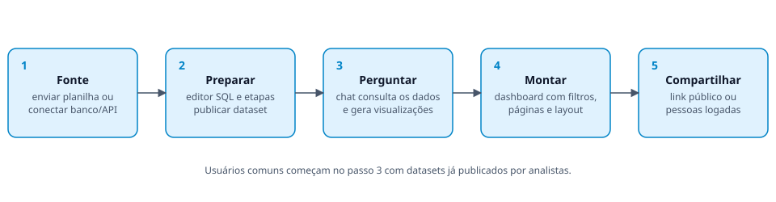

# SIGDATA

Plataforma de análise de dados que reúne, num só ambiente organizado por projetos, um **assistente de IA que consulta os
dados de verdade**, exploração de fontes, visualizações e **dashboards compartilháveis**. Funciona com CSV, XLSX,
PostgreSQL, MySQL/MariaDB, SQL Server, API REST e Google Sheets, sempre em leitura na origem.



## Documentação

| Documento | Conteúdo |
|---|---|
| [Visão geral](docs/01-visao-geral.md) | O que é, para quem serve, conceitos e limites |
| [Fluxo do sistema](docs/02-fluxo-do-sistema.md) | Da fonte ao dashboard compartilhado, com diagramas |
| [Guia de uso](docs/03-guia-de-uso.md) | Telas e passo a passo por perfil, atalhos |
| [Tecnologias e arquitetura](docs/04-tecnologias-e-arquitetura.md) | Stack, código, modelo de dados, segurança, configuração |
| [API](docs/05-api.md) | Rotas do backend |
| [Integração com o CIEGES PI](docs/06-integracao-cieges-pi.md) | Proposta e perguntas em aberto |

## Tecnologias

Next.js 16 · React 19 · TypeScript · Tailwind CSS v4 · Assistant UI · ECharts · Zustand — no backend, Node + Hono ·
Better Auth · PostgreSQL com Drizzle · DuckDB · AI SDK (Claude, Groq, OpenRouter ou API no formato OpenAI). Detalhes em
[Tecnologias e arquitetura](docs/04-tecnologias-e-arquitetura.md).

## Estrutura

```
sigdata-dev/
├─ frontend/          Next.js 16 — só interface (porta 3000)
├─ backend/           Node + Hono — API, autenticação, banco, motor analítico, IA (porta 4000)
├─ shared/            tipos de domínio e dados de demonstração usados pelos dois (TS puro)
├─ docker-compose.yml Postgres de desenvolvimento (porta 5434)
└─ package.json       scripts que orquestram tudo
```

O navegador só fala com o frontend. O Next.js repassa `/api/*` para o backend
(`rewrites` em `frontend/next.config.ts`), então frontend e API ficam na mesma origem e
o cookie de sessão funciona sem CORS.

## Rodando localmente

Pré-requisitos: Node 24+ e Docker Desktop aberto.

```bash
npm run setup                          # instala raiz, backend e frontend
cp backend/.env.example backend/.env   # preencha os segredos e a chave do provedor de IA (ANTHROPIC_API_KEY, GROQ_API_KEY ou OPENROUTER_API_KEY; veja AI_PROVIDER no .env.example)
cp frontend/.env.example frontend/.env.local
npm run db:up                          # Postgres 17 (projeto compose "sigdata-dev")
npm run db:migrate                     # cria as tabelas
npm run dev                            # sobe backend (4000) e frontend (3000)
```

Abra http://localhost:3000 e crie uma conta. Cada conta nova recebe uma fonte de
demonstração consultável e três dashboards de exemplo.

## Onde fica cada coisa

| Quero mexer em… | Pasta |
|---|---|
| Telas, componentes, estilos | `frontend/app`, `frontend/components` |
| Estado da interface (stores Zustand) e chamadas à API | `frontend/lib/**/store.ts`, `frontend/lib/api/client.ts` |
| Redirecionamento para login | `frontend/proxy.ts` |
| Rotas da API | `backend/src/routes/*.ts` (montadas em `backend/src/server.ts`) |
| Login / sessão | `backend/src/auth.ts` (Better Auth) |
| Tabelas do banco e migrações | `backend/src/db/schema.ts`, `backend/drizzle/` |
| Fontes de dados, DuckDB, bancos externos (Postgres, MySQL, SQL Server), API REST, Google Sheets, datasets | `backend/src/sources/` |
| Editor SQL (frontend) | `frontend/components/fontes/sql/`, `frontend/lib/sql-editor/` |
| Testes automatizados | `backend/test/`, `frontend/test/` |
| Chat: prompt, ferramenta `consultar_dados`, salvamento da conversa | `backend/src/chat.ts`, `backend/src/routes/chat.ts` |
| Tipos usados nos dois lados | `shared/` (alias `@shared/*`) |

## Segurança das consultas

- Só uma instrução `SELECT`/`WITH` por vez, executada como subconsulta com `LIMIT`.
- DuckDB aberto somente-leitura, sem acesso a arquivos/extensões e com configuração travada.
- Bancos externos consultados ao vivo, sempre em leitura e com limite de 15 s: Postgres e MySQL/MariaDB em
  transação `READ ONLY` com `ROLLBACK`; SQL Server não tem esse modo, então aceita só `SELECT`/`WITH` (sem `INTO`,
  `EXEC`, `OPENROWSET`…) e pede um usuário só de leitura.
- API REST e Google Sheets (planilha compartilhada por link) são **importadas**: os dados viram uma tabela no DuckDB
  da fonte, e "Atualizar dados" busca de novo. Cabeçalhos e endereço ficam criptografados; cada conexão (e
  redirecionamento) passa pela checagem de rede interna (`net-guard.ts`).
- MySQL e SQL Server não têm o dialeto das etapas da preparação de dados: a tabela (até 50 mil linhas) é copiada em
  leitura para a memória e as etapas rodam lá.
  Use um usuário só de leitura mesmo assim.
- Senhas de conexões externas criptografadas com AES-256-GCM (`SIGDATA_ENCRYPTION_KEY`).

## Scripts (na raiz)

| Script | Uso |
|---|---|
| `npm run dev` | backend + frontend juntos |
| `npm run dev:backend` / `dev:frontend` | só um dos lados |
| `npm run db:up` / `db:down` | sobe/derruba o Postgres |
| `npm run db:generate` | gera migração após alterar `backend/src/db/schema.ts` |
| `npm run db:migrate` | aplica migrações |
| `npm run db:studio` | Drizzle Studio |
| `npm run typecheck` | checa tipos dos dois projetos |
| `npm test` | testes do backend e do frontend |

## Workspace: chat, notas e estúdio

O workspace de cada projeto tem o chat no centro e, à direita, o **Estúdio**: ferramentas (resumo executivo,
insights, perguntas sugeridas, qualidade dos dados), as **visualizações** salvas e as **notas** do projeto.
Qualquer resposta do assistente pode ser fixada como nota (ícone de marcador abaixo da resposta), e o tipo de
gráfico pode ser trocado no próprio chat antes de salvar. Resumo e insights são pedidos ao assistente (que consulta
os dados); a qualidade dos dados é uma verificação determinística do perfil das colunas, sem IA.

## Perfis de acesso

| Perfil | Pode |
|---|---|
| Usuário | criar projetos e dashboards próprios e usar os datasets **publicados** |
| Analista | além disso: importar fontes, usar o editor SQL, criar e publicar datasets |
| Administrador | tudo do analista em qualquer fonte, mais gerenciar usuários e perfis (`/admin/usuarios`) |

A primeira conta criada vira administradora. O admin cria contas em `/admin/usuarios` ("Novo usuário"): a pessoa
recebe um link de primeiro acesso (24 h) para definir a senha, que o admin copia ou que segue por e-mail. O
autocadastro na tela de login fica aberto em desenvolvimento e **fechado em produção**; mude com
`SIGDATA_OPEN_SIGNUP=true|false`. Com ele fechado, o login mostra que o acesso é por convite.
Projetos e dashboards são sempre privados de quem os criou (o admin vê só as contagens). Um dataset em
rascunho só aparece para quem o criou e para o admin; ao publicar, todos o enxergam e podem usá-lo.
Despublicar faz projetos e dashboards de outras pessoas que o usam deixarem de funcionar até nova publicação.
O admin também desativa/reativa e remove contas (datasets publicados de quem é removido passam para ele) e
vê o registro de atividades em `/admin/atividades` (fontes, datasets, contas, links e compartilhamentos).
Antes de despublicar ou excluir um dataset em uso, a tela mostra quantos dashboards e projetos serão afetados.
Um dashboard pode ser compartilhado com pessoas logadas (por e-mail, ou com todos os usuários), em somente
leitura, além do link público. Contas novas só recebem a fonte e os dashboards de demonstração fora de
produção (`SIGDATA_SEED_DEMO`). As regras valem no backend (`handle(..., { roles })`); esconder menus no frontend é só conveniência.

## Produção

```bash
docker compose -f docker-compose.prod.yml up -d --build   # Postgres + backend + frontend
```

Defina `POSTGRES_PASSWORD`, `BETTER_AUTH_SECRET`, `BETTER_AUTH_URL`, `SIGDATA_ENCRYPTION_KEY` e `ANTHROPIC_API_KEY` (ou `GROQ_API_KEY`)
em um `.env` na raiz. O backend aplica as migrações ao iniciar (`dist/migrate.js`) e expõe `/api/health`
(vivo) e `/api/ready` (confere o banco). Sem build do Docker: `npm run build` na raiz gera `backend/dist`.

Em produção, conexões com bancos externos em rede interna (localhost, 10.x, 192.168.x, metadados de nuvem)
são recusadas; libere com `SIGDATA_ALLOW_PRIVATE_HOSTS=true` só se for necessário. Para recuperação de senha por
e-mail configure `RESEND_API_KEY` (sem ela, o link aparece no log do servidor).

## Testes

`npm test` roda backend e frontend. Os testes de integração do backend criam o banco descartável `sigdata_test`
no Postgres do `npm run db:up` (ou em `TEST_PG_ADMIN_URL`) e são pulados se ele não estiver disponível.
