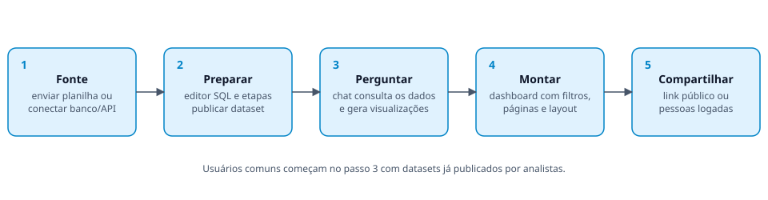

# 01 · Visão geral

O SIGDATA é uma plataforma de análise de dados que reúne, num só ambiente organizado por **projetos**:

- um **assistente de IA** que consulta os dados de verdade (nunca inventa números);
- **exploração** de dados: fontes, tabelas, colunas, amostras e perfil de qualidade;
- **visualização**: gráficos, mapas, tabelas e indicadores;
- **dashboards** editáveis, com filtros, várias páginas e compartilhamento.

Ele **não é um chatbot genérico** nem uma coleção de dashboards estáticos: a conversa produz resultados analíticos
(consultas, tabelas, gráficos, indicadores) que podem ser examinados, ajustados, organizados em painéis e compartilhados.

## Para quem é

| Perfil | O que faz no dia a dia |
|---|---|
| **Usuário** | Cria projetos, conversa com os dados de um dataset publicado, salva visualizações e monta dashboards próprios. |
| **Analista** | Tudo do usuário, mais: importa fontes, conecta bancos, usa o editor SQL, prepara dados e publica datasets. |
| **Administrador** | Tudo do analista em qualquer fonte, mais gerenciar usuários, perfis e consultar o registro de atividades. |

## Conceitos

| Termo | Significado |
|---|---|
| **Fonte** | Origem dos dados: planilha CSV/XLSX, PostgreSQL, MySQL/MariaDB, SQL Server, API REST ou Google Sheets. |
| **Dataset** | Fonte pronta para análise. Nasce em **rascunho** (só o autor e o admin veem) e, ao **publicar**, todos podem usá-lo. |
| **Projeto** | Espaço de trabalho de uma pessoa: tem conversas, visualizações salvas, notas e uma fonte ativa. Sempre privado. |
| **Visualização** | Resultado de uma consulta mostrado como gráfico, tabela ou indicador. Pode ser salva no projeto. |
| **Dashboard** | Página (ou várias) montada com visualizações, filtros, textos e outros elementos. |
| **Análise** | Visualização salva que dashboards reutilizam. |

## O que o sistema faz

- Chat que usa a ferramenta `consultar_dados` (SQL de leitura) e cria visualizações com `create_visualization`.
- Tipos de visualização: linha, barras, barras horizontais, área, combinado, pizza, rosca, dispersão, radar, funil,
  medidor, treemap, mapa de calor, mapas por UF e município (coroplético e bolhas), mapa de pontos por latitude e longitude,
  indicador (KPI) e tabela.
- Editor SQL com resultados paginados, preparação de dados em etapas (estilo Power Query) e cruzamento de fontes.
- Dashboards com filtros, filtro cruzado entre gráficos, drill-down, medidas calculadas, várias páginas,
  histórico de versões, layout para celular e exportação.
- Compartilhamento por **link público** (somente leitura, com validade opcional) ou com **pessoas logadas**
  (por e-mail ou com todos os usuários).
- Administração: usuários, perfis, convites por link e registro de atividades.

## O que o sistema não faz

- Não altera os bancos de origem: tudo é somente leitura na origem, e resultados ficam em cópias.
- Não executa mais de uma instrução SQL por vez nem comandos que gravem.
- Não calcula números fora da consulta: o assistente só apresenta valores que vieram de `consultar_dados`.
