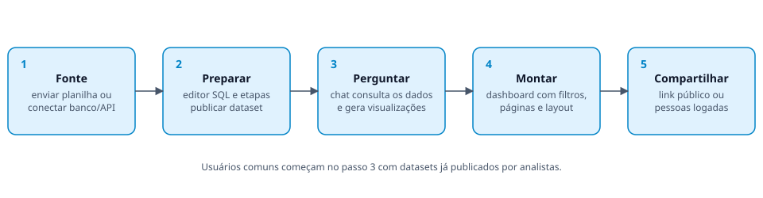
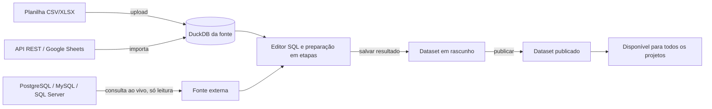
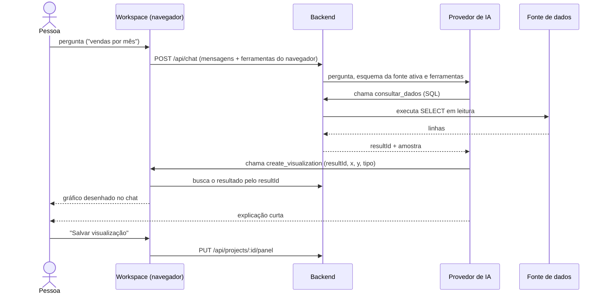
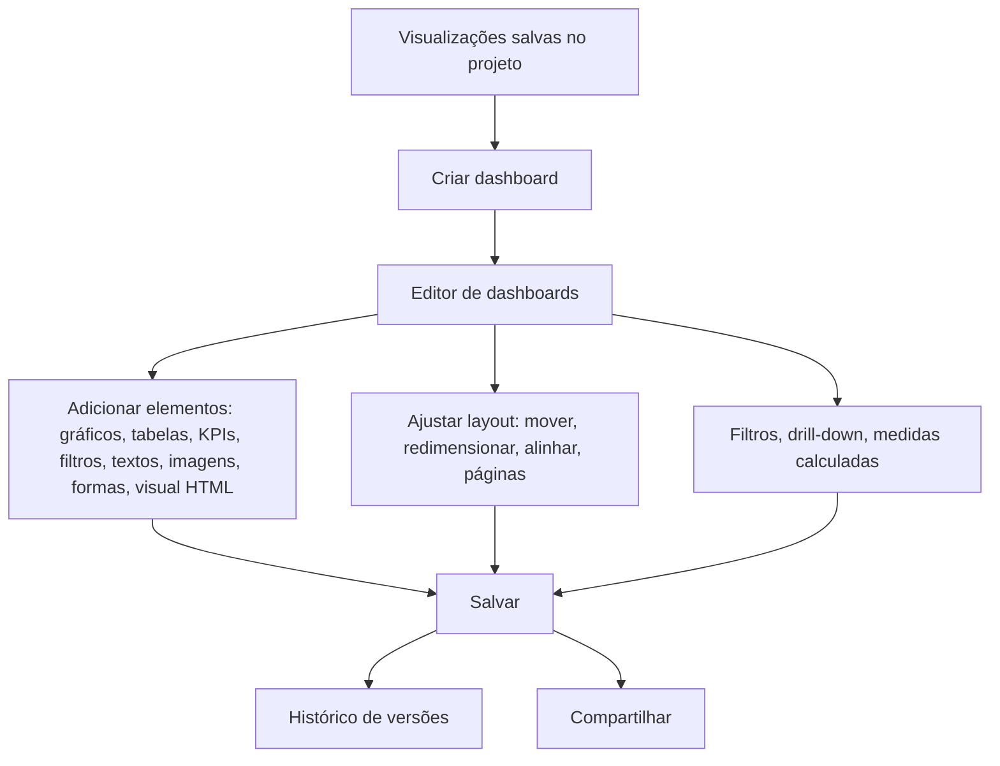
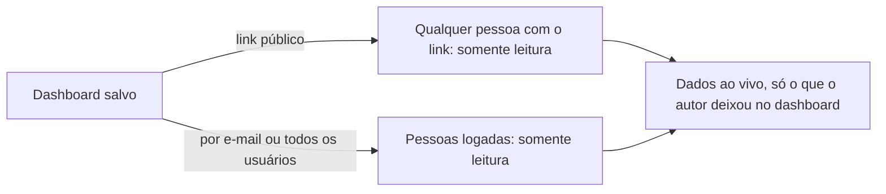

# 02 · Fluxo do sistema

Este documento segue o caminho dos dados, da origem ao dashboard compartilhado. Os nomes de rotas estão detalhados em
[05 · API](05-api.md).

## 1. Visão de ponta a ponta

1. **Fonte**: alguém envia uma planilha ou conecta um banco ou uma API.
2. **Preparar**: o analista limpa e transforma os dados e **publica** o resultado como dataset.
3. **Perguntar**: no workspace de um projeto, a pessoa conversa com o assistente sobre o dataset.
4. **Montar**: as visualizações salvas viram um dashboard.
5. **Compartilhar**: o dashboard é aberto por link público ou por pessoas logadas, sempre em somente leitura.

Usuários comuns começam no passo 3, com datasets já publicados. Qualquer perfil também pode enviar uma planilha direto no
projeto (ela fica só naquele projeto).

## 2. Da origem ao dataset

- **Importadas** (CSV, XLSX, API REST, Google Sheets): os dados viram uma tabela no DuckDB da fonte. "Atualizar dados" busca de novo.
- **Ao vivo** (PostgreSQL, MySQL/MariaDB, SQL Server): cada consulta vai ao banco de origem, sempre em leitura e com limite de tempo.
- **Dataset**: nasce em rascunho. Ao publicar, todos o enxergam. Despublicar ou excluir mostra antes quantos dashboards e
  projetos dependem dele.

## 3. A conversa no workspace

Pontos importantes:

- Todo número exibido vem de `consultar_dados`; o modelo não inventa valores.
- O resultado completo fica no servidor (`resultId`); o navegador desenha o gráfico a partir dele.
- As mensagens da conversa são gravadas pelo servidor.
- No campo de mensagem, `@` cita uma tabela da fonte do projeto e `/` abre atalhos de pedido.
- Há limite de mensagens por usuário por minuto (`CHAT_RATE_LIMIT_PER_MIN`).

## 4. Do chat ao dashboard

- O dashboard também pode ser montado pelo **assistente do editor**, que adiciona e edita elementos no navegador. Tudo vira
  um passo de "desfazer" e só é gravado quando a pessoa salva.
- Elementos de dados ficam **ligados à fonte**: o dashboard mostra dados atuais, não uma cópia.
- A pessoa pode restaurar versões anteriores no histórico.

## 5. Compartilhamento

- Quem vê escolhe apenas valores dos filtros que o autor salvou; o servidor valida colunas e níveis de drill-down contra a versão salva.
- O link público pode ter validade e ser revogado.
- Projetos e dashboards são privados de quem os criou. O admin vê só contagens.

## 6. Perfis e acesso

| Ação | Usuário | Analista | Administrador |
|---|:---:|:---:|:---:|
| Criar projetos e dashboards próprios | ✔ | ✔ | ✔ |
| Usar datasets publicados | ✔ | ✔ | ✔ |
| Enviar planilha no próprio projeto | ✔ | ✔ | ✔ |
| Importar fontes, conectar bancos, editor SQL, publicar datasets | | ✔ | ✔ |
| Gerenciar usuários, perfis e ver atividades | | | ✔ |

As regras valem no **backend**; esconder menus no frontend é só conveniência. A primeira conta criada vira administradora.
