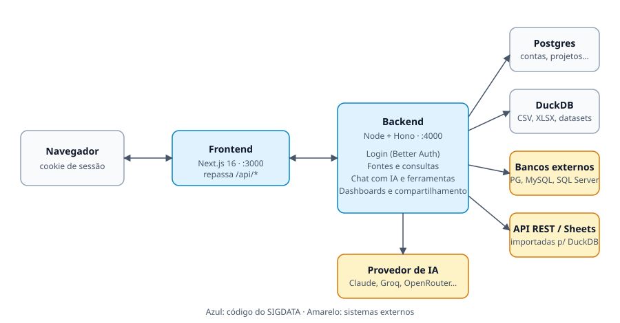

# 04 · Tecnologias e arquitetura

## Visão geral



O navegador só fala com o **frontend**. O Next.js repassa `/api/*` para o **backend** (`rewrites` em
`frontend/next.config.ts`), então frontend e API ficam na **mesma origem** e o cookie de sessão funciona sem CORS.

## Stack

| Camada | Tecnologia |
|---|---|
| Interface | Next.js 16 (App Router, `proxy.ts`), React 19, TypeScript estrito |
| Estilo e componentes | Tailwind CSS v4 (configuração via `@theme` no CSS), componentes no estilo shadcn sobre Base UI |
| Chat | Assistant UI (`@assistant-ui/react`, `@assistant-ui/ai-sdk`) |
| Estado da interface | Zustand (`frontend/lib/**/store.ts`), que chama a API |
| Gráficos | ECharts 6 |
| Edição de elementos no dashboard | react-rnd (mover e redimensionar) |
| API | Node + Hono (porta 4000) |
| Autenticação | Better Auth (sessão por cookie) |
| Banco do sistema | PostgreSQL 17 com Drizzle ORM e migrações |
| Motor analítico | DuckDB (`@duckdb/node-api`) para planilhas, imports e datasets |
| Bancos externos | `pg` (PostgreSQL), MySQL/MariaDB e `mssql` (SQL Server), sempre em leitura |
| IA | AI SDK v7 com Claude, Groq, OpenRouter ou qualquer API no formato OpenAI (Ollama, Gemini…) |
| Validação | Zod nos dois lados |
| Qualidade | `tsc`, oxlint, testes com o runner do Node, GitHub Actions com Postgres |
| Entrega | Docker Compose (`docker-compose.prod.yml`) |

## Organização do código

```
sigdata/
├─ frontend/          Next.js: só interface
│  ├─ app/            rotas (login, workspace, projetos, dashboards, fontes-de-dados, admin, compartilhado…)
│  ├─ components/     por área: sigdata/ (workspace), dashboards/, fontes/, charts/, assistant-ui/, ui/
│  └─ lib/            stores Zustand, cliente da API, motor de gráficos e utilitários
├─ backend/
│  ├─ src/routes/     rotas Hono por assunto
│  ├─ src/sources/    fontes: DuckDB, bancos externos, imports, preparação em etapas
│  ├─ src/db/         schema Drizzle   ·   drizzle/  migrações
│  └─ test/           testes (unitários e de integração)
└─ shared/            tipos de domínio (TS puro, alias @shared/*)
```

Regras do projeto: código de servidor nunca vai no `frontend/`; tipo usado pelos dois lados vai em `shared/`;
telas usam os **stores**, que chamam a API (nada de `localStorage` para dados de domínio).

## Modelo de dados (Postgres)

| Tabela | Guarda |
|---|---|
| `user`, `session`, `account`, `verification` | Contas e sessões (Better Auth) |
| `data_sources` | Fontes e datasets, esquema detectado, credenciais criptografadas |
| `projects` | Projetos (privados do dono) e a fonte ativa |
| `chats`, `messages` | Conversas e mensagens de cada projeto |
| `project_panels` | Visualizações salvas do projeto |
| `project_notes` | Notas do projeto |
| `results` | Resultados de consultas (referenciados por `resultId`) |
| `analyses` | Visualizações salvas reutilizadas pelos dashboards |
| `dashboards`, `dashboard_versions` | Dashboards e o histórico de versões |
| `dashboard_shares` | Link público e acessos por pessoa |
| `audit_log` | Registro de atividades |

Arquivos enviados e bancos DuckDB ficam em `SIGDATA_STORAGE_DIR` (padrão `./storage`).

## Como o chat funciona

1. O navegador envia as mensagens e as ferramentas que ele mesmo executa (como `create_visualization`).
2. O backend monta o prompt com o esquema da fonte ativa e acrescenta `consultar_dados`, que roda no servidor.
3. O modelo consulta, depois pede a visualização; o navegador desenha o gráfico a partir do `resultId`.
4. Ferramentas do navegador (visualizações, dashboards) operam sobre os stores. O servidor só valida e grava quando a pessoa salva.
5. Há um agente separado para o editor de dashboards (`/api/chat/dashboard`) e outro para o código dos visuais HTML (`/api/chat/html`, só analistas e admins).

## Segurança

- **Consultas**: uma única instrução `SELECT`/`WITH` por vez, executada como subconsulta com `LIMIT`.
- **DuckDB**: aberto somente leitura, sem acesso a arquivos ou extensões e com a configuração travada.
- **Bancos externos**: leitura com limite de 15 s. PostgreSQL e MySQL em transação `READ ONLY` com `ROLLBACK`; SQL Server aceita só
  `SELECT`/`WITH` (sem `INTO`, `EXEC`, `OPENROWSET`…). Use sempre um usuário só de leitura.
- **Segredos**: senhas e cabeçalhos de conexões externas criptografados com AES-256-GCM (`SIGDATA_ENCRYPTION_KEY`).
- **Rede**: cada conexão e redirecionamento passa pela checagem de rede interna (`net-guard.ts`). Em produção, localhost, 10.x, 192.168.x e
  metadados de nuvem são recusados, salvo `SIGDATA_ALLOW_PRIVATE_HOSTS=true`.
- **Acesso**: perfis validados no backend (`handle(..., { roles })`). Projetos e dashboards são sempre privados do criador.
- **Compartilhamento**: quem vê só executa ligações que estão na versão salva e escolhe valores de filtros salvos; colunas e níveis de
  drill-down são derivados do dashboard, nunca do visitante.
- **Limites**: mensagens de chat por usuário por minuto, tempo máximo de consulta e limite de 5.000 linhas por resultado.
- **Rastro**: `audit_log` com fontes, datasets, contas, links e compartilhamentos.

## Configuração

Variáveis do backend (`backend/.env.example`):

| Variável | Para quê |
|---|---|
| `DATABASE_URL` | Postgres do sistema |
| `BETTER_AUTH_SECRET`, `BETTER_AUTH_URL` | Sessões; a URL é a do **frontend** |
| `SIGDATA_ENCRYPTION_KEY` | Criptografia das credenciais (32 bytes em base64) |
| `AI_PROVIDER` e a chave do provedor | `anthropic`, `groq`, `openrouter` ou `openai-compatible` |
| `SIGDATA_OPEN_SIGNUP` | Autocadastro aberto (fora de produção) ou fechado (produção) |
| `SIGDATA_SEED_DEMO` | Fonte e dashboards de demonstração em contas novas |
| `SIGDATA_ALLOW_PRIVATE_HOSTS` | Libera bancos em rede interna |
| `CHAT_RATE_LIMIT_PER_MIN` | Limite de mensagens por usuário |
| `RESEND_API_KEY`, `MAIL_FROM` | E-mails de recuperação e convite |

## Operação

- `/api/health` responde se o processo está vivo; `/api/ready` confere o banco.
- O backend aplica as migrações ao iniciar.
- Limite do provedor de IA: provedores gratuitos têm cotas baixas (o Groq, por exemplo, limita os tokens de entrada por minuto), o que
  restringe fluxos com vários passos de ferramenta. Em produção, use um plano adequado.
